# MuleNetX — Implementation Plan for a Coding Agent

Oct 17, 2026 · @Partha · built from **SRS v1.3.3** (`docs/SRS.md`)

## 0. How to use this plan

This plan turns SRS v1.3.3 into an ordered build. A coding agent follows it task by task, T01 to T45. It implements every task and stops only for a failing gate it cannot fix inside the task, or for a question that §0.3 says to raise.

### 0.1 Source precedence

1. **SRS v1.3.3** (`docs/SRS.md`, a verbatim copy of `MuleNetX_SRS_v1.3.3.md`) is the normative contract for **what** to build: every formula, schema, endpoint, limit, error code, and acceptance test.
2. **This plan** decides **how** and **in what order**: repository layout, libraries, module boundaries, task order, and test layout. It never changes SRS behavior.
3. If this plan and the SRS disagree, the SRS wins. The agent records the conflict in `docs/OPEN_QUESTIONS.md` and implements the SRS behavior.

Every task lists the SRS sections it implements under **Read**. The agent reads those sections in full before writing code for that task; the summaries in this plan exist to orient, not to replace them.

### 0.2 Execution rules for the agent

1. Implement only the current task. Run its **Validate** command. Do not start the next task until **Acceptance** holds and all earlier tests still pass.
2. One logical commit per task, message `T07: job queue and worker`.
3. Never add a dependency, table, column, endpoint, configuration key, error code, enum value, or pipeline state that is not in the SRS or in this plan.
4. Every number in code (weights, thresholds, windows, caps, limits) comes from configuration or a versioned registry file whose value is cited from the SRS section. No magic numbers in service code.
5. Every analytical computation is deterministic: fixed iteration order, explicit seeds, decimal rounding where the SRS says so, deterministic identifiers (§3.3). No `set` or `dict` iteration order may influence output; sort first.
6. Event time and processing time are never compared (SRS §3.4). Columns named `timestamp`, `data_cutoff`, `as_of`, `start_time`, `end_time` are event time. `created_at`, `computed_at`, `generated_at`, `started_at`, `completed_at` are processing time.
7. Service code never imports FastAPI. Route code never contains analytical formulas (SRS §18.1).
8. Each acceptance test ID in the SRS (§28.2) becomes a test whose name contains the ID, for example `test_AT_PROP_03_counterexample_order_independent`. T45 checks this mechanically.
9. Keep `make lint`, `make typecheck`, and `make test` green at the end of every task.

### 0.3 When the SRS is silent

- If this plan states a default for the point, use it. Plan defaults are marked **[PLAN DEFAULT]**.
- If neither the SRS nor this plan answers it, do not invent behavior that a user or test could observe. Write the question in `docs/OPEN_QUESTIONS.md` with the task ID, the options, and the one you would pick. Implement the smallest internal choice that keeps going only if it is invisible outside the module and easy to change; otherwise stop the task and report.
- Never resolve a question by weakening a test, skipping a test, or loosening a limit.

### 0.4 Open decisions the plan assumes

SRS §1.6 froze five defaults that Partha has not yet confirmed (SRS Appendix G, G-01 to G-05). This plan is built on them:

| ID | Assumed default | Where it shows up in the plan |
|---|---|---|
| DEC-01 | PaySim reference slice (≤ 1,000,000 rows) and NetworkX in the worker | T09 slice, T13 analytics engine |
| DEC-02 | Profiling report for every dataset; synthetic injection off | T10; synthetic injection is **not built** (SRS §7.10 is MAY) |
| DEC-03 | Feature regime `RISK_FEATURES_UNAVAILABLE` | T15, T17, T18 |
| DEC-04 | One active dataset | T12 activation |
| DEC-05 | Retrospective detection | T16 |

If Partha changes one, update `docs/SRS.md` first (new SRS revision), then the affected tasks.

---

## 1. Executive summary

MuleNetX is a graph-native financial-crime investigation platform. It ingests PaySim transactions into PostgreSQL, builds a validated Neo4j graph snapshot, computes graph analytics, temporal motifs and a 42-feature vector per account, trains an XGBoost model, composes an explainable analytical risk score with bounded propagation, detects potential fraud-ring candidates with ring-level intelligence, simulates hypothetical network interventions, evaluates itself at four levels, and supports investigators with cases, findings, a D3 dashboard and a local Ollama/Qwen copilot.

**Runtime shape.** One Python codebase runs as two processes: `backend` (FastAPI, serves the API, never does long work) and `worker` (claims jobs from a PostgreSQL table and runs pipeline stages, training, simulations, evaluation). PostgreSQL is canonical. Neo4j is derived and rebuildable. Ollama is optional. Everything starts with `docker compose up --build`.

**Build order.** Five phases from SRS §1.7, each closed by an acceptance-test gate, plus an optional copilot track and a final hardening phase. Pipeline stages owned by later phases exist from Phase 1 as recorded no-op stages, so the state machine is complete from the start.

---

## 2. Technology (frozen for this plan)

Versions are minimums within a major line. The agent pins exact versions in `backend/uv.lock` and `frontend/package-lock.json` in T01 and never upgrades a major version later.

| Concern | Choice | SRS basis |
|---|---|---|
| Language | Python 3.12 | — |
| API | FastAPI ≥ 0.115, Uvicorn | title block |
| ORM / migrations | SQLAlchemy 2.0 (typed ORM + Core), Alembic ≥ 1.13 | §6.3, §6.7 |
| PostgreSQL driver | psycopg 3 (`psycopg[binary]`), `COPY` support | §7.2 |
| Settings / schemas | pydantic 2, pydantic-settings | §23 |
| Graph DB | Neo4j 5 Community (image `neo4j:5`), official `neo4j` Python driver 5.x | §6.8 |
| Graph algorithms | NetworkX 3.x (`pagerank`, `betweenness_centrality`, `weakly_connected_components`, `louvain_communities(seed=42)`) | §8.2, DEC-01 |
| Numerics | NumPy; Python `decimal` for scores | §12.4 |
| ML | XGBoost 2.x (`tree_method="hist"`, `nthread=1`), scikit-learn (metrics only: PR-AUC, ROC-AUC) | §11.8, §11.10 |
| Explainability | `shap` (TreeExplainer) | §14 |
| Password hashing | `argon2-cffi` (Argon2id) | §22.1 |
| HTTP client (Ollama) | `httpx` | §21 |
| Package manager | `uv` | **[PLAN DEFAULT]** |
| Lint / types / tests | ruff, mypy (strict on `mulenetx/`), pytest, pytest-asyncio, hypothesis (property tests for formulas) | §27 |
| Frontend | React 18, TypeScript 5, Vite 5, D3 7, Zustand 4, React Router 6 | title block, §20 |
| Frontend tests | Vitest, React Testing Library, MSW; Playwright for the E2E smoke | §27.7 |
| LLM | Ollama (image `ollama/ollama`), model tag `qwen2.5:7b-instruct` **[PLAN DEFAULT]**, configurable via `OLLAMA_MODEL` | §21.8, §23.2 |
| Deployment | Docker Compose; PostgreSQL 16 image | §26 |

**Not allowed** (not in the SRS): Redis, Celery, Kafka, RabbitMQ, any broker or scheduler (SRS §4.4: the queue is a PostgreSQL table), Neo4j GDS on the reference tier, pandas in service code (NumPy and SQL cover every computation), WebSockets, cloud LLM APIs, TanStack Query or another state library besides Zustand, any CSS framework beyond plain CSS modules **[PLAN DEFAULT]**.

---

## 3. Cross-cutting conventions

### 3.1 Identifiers (SRS §6.2)

- `account_id = f"{dataset_key}:{source_account_ref}"`, `transaction_id = f"{dataset_key}:{source_transaction_ref}"`. Both `VARCHAR(160)`.
- `dataset_key` matches `[a-z0-9_-]{1,24}`. **[PLAN DEFAULT]** generation rule: the `POST /ingestion` request's `name` lower-cased, non-matching characters replaced by `-`, truncated to 16 characters, plus `-v` and the `dataset_version` sanitized the same way, truncated to 24 total. If that key already exists the request fails with `409 DATASET_ALREADY_REGISTERED` only when checksum and version also match; otherwise append `-2`, `-3`, … within 24 characters.
- PaySim `source_transaction_ref` = 1-based row ordinal zero-padded to 10 digits.

### 3.2 Deterministic identifiers (SRS §6.2.3)

`mulenetx/core/ids.py` exposes one function per identifier in the §6.2.3 table, each building the content string exactly as written there (fields joined with `|`, lists sorted ascending and joined with `,`) and returning `uuid.uuid5(UUID("6f1c2a3e-5b7d-4e0a-9c1f-2d8b4a6e0f13"), content)`. Unit tests freeze one known output per function. Administrative primary keys (users, cases, findings, audit events, jobs, runs, scenarios) use `uuid.uuid4()`.

### 3.3 Decimal scores (SRS §12.4)

`mulenetx/core/decimal.py`: `D(x)` converts via `Decimal(str(x))`; `round7(d)` = `d.quantize(Decimal("0.0000001"), rounding=ROUND_HALF_EVEN)`; `clamp(d, 0, 1)`. Every stored `NUMERIC(8,7)` score passes through `round7` immediately before persistence and before tier assignment. ML probabilities from XGBoost (float) enter the decimal domain through `D()` at the start of composition. Amounts use `NUMERIC(20,6)` per SRS §6.3 and are rounded half-even to 6 dp at ingestion.

### 3.4 Time (SRS §3.4)

All timestamps are timezone-aware UTC (`TIMESTAMPTZ`). PaySim `timestamp = epoch_anchor + step hours`, `epoch_anchor = 2020-01-01T00:00:00Z`, `timestamp_resolution_seconds = 3600`. Window bounds are half-open `(T − w, T]` (SRS §10.1). Hour buckets are UTC-aligned.

### 3.5 Ordering

| Thing | Order (SRS) |
|---|---|
| Transactions | `(timestamp, transaction_id)` ascending (§15.9.1) |
| Projection export | nodes by `account_id`, edges by `(source, destination)` (§8.1) |
| Paths | §16.5 order |
| Accounts in lists | `account_id` ascending (§9A.5) |
| Transaction API pages | keyset on `(timestamp DESC, transaction_id DESC)` (§19.6) |
| Neighborhood truncation | BFS by `(hop, total_amount desc, account_id)` (§19.2) |

### 3.6 Errors and responses (SRS §19.3, §19.11, §19.12)

- One `AppError(code, http_status, message, details)` class. Handlers map it to the envelope `{"error": {"code", "message", "request_id", "details"}}`. Unknown exceptions → `500 INTERNAL` with a generic message; the stack trace goes to logs only.
- Error codes used in the SRS (create them as constants in `mulenetx/core/error_codes.py`; add no others without an SRS change): `LIMIT_EXCEEDED`, `INVALID_PATH_REQUEST`, `INTERVENTION_TARGET_INVALID`, `INVALID_CREDENTIALS`, `RISK_NOT_AVAILABLE`, `EXPLANATION_NOT_AVAILABLE`, `EVALUATION_NOT_AVAILABLE`, `QUERY_TIMEOUT`, `CASE_VERSION_CONFLICT`, `INVALID_CASE_TRANSITION`, `DATASET_ALREADY_REGISTERED`, `EXPLANATION_VERSION_MISMATCH`, `PIPELINE_ALREADY_RUNNING`, `PIPELINE_PREREQUISITE_MISSING`, `RING_INTELLIGENCE_NOT_APPLICABLE`, `SCENARIO_NOT_COMPLETED`, `SNAPSHOT_RETIRED`, `COPILOT_BUSY`, `AI_RESPONSE_INVALID`, `COPILOT_UNAVAILABLE`, `GRAPH_UNAVAILABLE`, `MODEL_UNAVAILABLE`. Generic codes for standard statuses **[PLAN DEFAULT]**: `VALIDATION_ERROR` (400), `UNAUTHENTICATED` (401), `FORBIDDEN` (403), `NOT_FOUND` (404), `CONFLICT` (409), `PAYLOAD_TOO_LARGE` (413), `UNSUPPORTED_MEDIA_TYPE` (415), `RATE_LIMITED` (429), `INTERNAL` (500), `DB_UNAVAILABLE` (503). The SRS says the stable list is "generated from the implementation" (§19.3); T45 exports it to `docs/api-errors.md`.
- Above-limit parameters → `400 LIMIT_EXCEEDED`, never clamped (§19.1).
- Offset pages return `{items, page, page_size, total, total_is_capped}`; `total` capped at 10,000 (§19.11). Cursor pages return `{items, next_cursor}`; the cursor is base64url JSON of the last `(timestamp, transaction_id)`.
- Analytical responses carry `{lineage, computed_at, is_stale}`; `is_stale` compares each lineage element with `active_context` (§19.12).

### 3.7 Database access

- `mulenetx/db/models/*.py` declares tables; `mulenetx/db/repositories/*.py` holds all SQL. Services take repositories in their constructor. Route handlers get a request-scoped session from `api/deps.py`.
- Bulk analytical writes use `COPY` or `INSERT … ON CONFLICT DO NOTHING` in batches of 10,000 **[PLAN DEFAULT]**.
- Two database roles (SRS §6.5): `mulenetx_owner` runs migrations and owns tables; `mulenetx_app` is used by `backend` and `worker` and lacks `UPDATE`/`DELETE` on the append-only tables. Credentials come from `POSTGRES_DSN` (app) and `POSTGRES_OWNER_DSN` (migrate service only) **[PLAN DEFAULT: second DSN; §23 names one DSN, the owner role of §6.5 needs its own]**.

### 3.8 Logging (SRS §24.1)

JSON lines with `ts, level, request_id, user_id, endpoint, operation, status, latency_ms, error_category` for requests and `job_id, kind, attempt, stage` for jobs. Never log passwords, tokens, token hashes, copilot question or answer text.

### 3.9 Configuration (SRS §23)

`mulenetx/core/config.py` defines one pydantic-settings class with every key of SRS §23.2, its baseline value, and validation. Keys marked **V** in §23.2 are read only when a new version record is created (analytics run, feature version, model version, risk logic version) and copied into that record; computations read them from the version record, never from live settings. Startup fails on a missing required value or a default secret (`neo4j/neo4j`, empty passwords).

---

## 4. Repository structure (frozen)

```text
mulenetx/
├── backend/
│   ├── Dockerfile
│   ├── pyproject.toml / uv.lock
│   ├── alembic.ini
│   ├── alembic/versions/                 # 0001..0006, see §6
│   ├── mulenetx/
│   │   ├── main.py                       # FastAPI app factory, routers, middleware
│   │   ├── worker.py                     # worker entrypoint: claim loop, heartbeat thread
│   │   ├── cli.py                        # bootstrap-admin, ingest --path, export-openapi, export-errors
│   │   ├── core/                         # config, logging, errors, error_codes, ids, decimal, timeutil,
│   │   │                                 # pagination, lineage (staleness), percentile
│   │   ├── db/                           # engine, session, base, models/, repositories/
│   │   ├── auth/                         # passwords, sessions, throttle, permissions (matrix), service
│   │   ├── audit/                        # service
│   │   ├── jobs/                         # queue, lease, runner, pipeline_state, stages/ (one module per stage)
│   │   ├── ingestion/                    # adapters/paysim_v1.py, staging, validation, slice, service
│   │   ├── profiling/                    # service
│   │   ├── graph/                        # neo4j_client, cypher (allow-listed queries), build, validate,
│   │   │                                 # retire, neighborhood, service
│   │   ├── activation/                   # service (§6.9)
│   │   ├── analytics/                    # projection (PG export), algorithms, communities, service
│   │   ├── features/                     # registry_v1.json, registry, transactional, temporal,
│   │   │                                 # graph_features, flow_features, encoding, service
│   │   ├── ml/                           # target, splits, leakage, train, artifacts, registry, inference
│   │   ├── explain/                      # shap_service
│   │   ├── risk/                         # normalization_reference, components, rules, compose, tiers, service
│   │   ├── propagation/                  # bfs, service
│   │   ├── flow/                         # vocabulary (suspicion predicates), ordering, interactive_paths,
│   │   │                                 # analytic_paths (work budget), service
│   │   ├── motifs/                       # common, rapid_pass_through, fan, circular, layered, burst,
│   │   │                                 # confidence, service
│   │   ├── rings/                        # candidates, membership, features, risk, evidence, service
│   │   ├── interventions/                # pool, residual, metrics, ranking, service
│   │   ├── evaluation/                   # reference, matching, metrics, service
│   │   ├── investigation/                # cases, subjects, findings, service
│   │   ├── copilot/                      # intents_v1.json, deny_list_v1.txt, context, prompt,
│   │   │                                 # ollama_client, validation, limiter, service
│   │   └── api/
│   │       ├── deps.py                   # session, current principal, permission checks
│   │       ├── middleware.py             # request id, logging, body size
│   │       ├── schemas/                  # pydantic request/response models per area
│   │       └── routes/                   # health, auth, users, ingestion, pipelines, models, context,
│   │                                     # accounts, graph, communities, rings, interventions,
│   │                                     # evaluation, cases, copilot, audit, aliases
│   └── tests/
│       ├── fixtures/                     # golden fixture CSVs + expected JSON (§8 of this plan)
│       ├── unit/                         # pure functions, no services
│       ├── integration/                  # PostgreSQL, Neo4j, jobs, Ollama (marked)
│       ├── api/                          # every endpoint (SRS §27.3)
│       ├── security/                     # SRS §27.6
│       ├── acceptance/                   # one test per AT-ID, named with the ID
│       ├── e2e/                          # AT-E2E-01, reliability (§27.12)
│       └── perf/                         # AT-OPS-05 harness (not in default `make test`)
├── frontend/
│   ├── Dockerfile                        # build static, serve with nginx
│   ├── package.json / package-lock.json
│   ├── src/
│   │   ├── api/                          # client.ts + one module per SRS §20.2 service
│   │   ├── state/                        # Zustand stores: session, context, ui
│   │   ├── components/                   # StateView (§20.4), EvidenceLabel (§20.5), Lineage, Paginator,
│   │   │                                 # GraphCanvas (D3), PathView, Table, Banner
│   │   ├── pages/                        # see T25–T28, T35, T39, T41
│   │   └── App.tsx
│   ├── tests/                            # Vitest + MSW
│   └── e2e/                              # Playwright golden path
├── docs/
│   ├── SRS.md                            # verbatim SRS v1.3.3
│   ├── PLAN.md                           # this file
│   ├── OPEN_QUESTIONS.md
│   ├── api-errors.md                     # generated
│   ├── openapi.json                      # generated
│   └── traceability.md                   # generated by T45
├── scripts/                              # make_reference_slice.py, check_traceability.py, bench.py
├── docker-compose.yml
├── .env.example
├── Makefile
└── README.md
```

Makefile targets: `up down logs migrate test test-backend test-frontend test-acceptance test-e2e lint typecheck bench gen-types traceability demo`.

---

## 5. SRS-to-module map

| SRS | Module | Service class (SRS §18.1) |
|---|---|---|
| §7.1–7.5 | `ingestion/` | IngestionService |
| §7.9 | `profiling/` | ProfilingService |
| §7.6–7.8 | `jobs/` | JobService |
| §6.8 | `graph/` | GraphService |
| §6.9 | `activation/` | (part of JobService; READY transition) |
| §8 | `analytics/` | AnalyticsService |
| §15.2–15.7, §10 | `features/` | FeatureService |
| §15.9 | `motifs/` | TemporalMotifService |
| §11 | `ml/` | MLService |
| §14 | `explain/` | ExplainabilityService |
| §12 | `risk/` | RiskService |
| §13 | `propagation/` | PropagationService |
| §3.5, §16 | `flow/` | MoneyFlowService |
| §9, §9A | `rings/` | RingIntelligenceService |
| §16A | `interventions/` | InterventionService |
| §28.7 | `evaluation/` | EvaluationService |
| §17 | `investigation/` | InvestigationService |
| §21 | `copilot/` | AIService |
| §22 | `auth/` | AuthService |
| §24.3 | `audit/` | AuditService |
| §19 read models | `db/repositories/accounts.py`, `transactions.py` | AccountService, TransactionService |

---

## 6. Database migration plan (SRS §6.3–§6.7)

Tables are defined exactly as in SRS §6.3, column by column, with every listed CHECK, UNIQUE, index, and FK. Migrations:

| Migration | Contents | Task |
|---|---|---|
| `0001_identity_canonical` | roles and grants scaffold; `users`, `auth_sessions`, `datasets`, `accounts` (without `latest_risk_assessment_id` FK), `transactions`, `audit_events` | T03 |
| `0002_pipeline_lineage` | `dataset_profiles`, `ingestion_runs`, `pipeline_runs`, `jobs`, `graph_snapshots`, `analytics_runs`, `feature_versions`, `model_versions`, `risk_logic_versions`, `scoring_runs`, `active_context` (singleton row: `singleton BOOLEAN PRIMARY KEY CHECK (singleton)`, inserted empty by the migration) | T03 |
| `0003_account_analytics` | `account_graph_metrics`, `account_feature_values`, `risk_assessments`, `propagation_contributions`, `shap_explanations`, `communities`, `community_memberships` (composite FKs to `communities(analytics_run_id, community_id)`) | T04 |
| `0004_rings_motifs_interventions` | `potential_fraud_ring_candidates` (UNIQUE `(scoring_run_id, analytics_run_id, community_id)`), `ring_memberships`, `ring_feature_sets`, `ring_risk_assessments`, `temporal_motifs` (GIN index per §6.3.6), `intervention_scenarios`, `intervention_candidates` | T04 |
| `0005_investigation_evaluation` | `cases`, `case_subjects`, `findings`, `evaluation_runs`, `evaluation_metrics` | T04 |
| `0006_constraints_immutability` | `accounts.latest_risk_assessment_id` FK (§6.7); privilege revokes on the append-only list of §6.5(1); `BEFORE UPDATE` triggers rejecting changes to "Imm." columns on partially mutable tables (§6.5(2)) | T04 |

The trigger is one PL/pgSQL function `reject_immutable_update()` that receives the immutable column list as trigger arguments and raises when `OLD.col IS DISTINCT FROM NEW.col` for any listed column. Generate the column lists from the "Mutable" column of SRS §6.3 (every column marked `Imm.`; `Once` columns may change only from NULL).

---

## 7. Process, job and pipeline architecture

### 7.1 Processes (SRS §4.4, §26)

| Compose service | Command | Notes |
|---|---|---|
| `postgres` | postgres:16 | healthcheck `pg_isready`; init script creates `mulenetx_owner`, `mulenetx_app` |
| `neo4j` | neo4j:5 | `NEO4J_AUTH` from env (default rejected); healthcheck via `cypher-shell` |
| `ollama` | ollama/ollama | not published |
| `ollama-pull` | one-shot `ollama pull $OLLAMA_MODEL` | `restart: "no"` |
| `migrate` | one-shot `alembic upgrade head` + Neo4j constraints | depends on postgres and neo4j healthy |
| `backend` | `uvicorn mulenetx.main:app --host 0.0.0.0 --port 8000` | depends on migrate completed successfully; port published |
| `worker` | `python -m mulenetx.worker` | depends on migrate completed successfully |
| `dashboard` | nginx serving the Vite build, proxying `/api` to backend **[PLAN DEFAULT]** | port published |

Only `dashboard` and `backend` publish ports (SR-22).

### 7.2 Job queue (SRS §7.8)

- Enqueue: insert resource row and `jobs` row (`QUEUED`) in one transaction, commit, then respond `202`.
- Claim (one statement):

```sql
UPDATE jobs SET status='RUNNING', attempts=attempts+1, lease_owner=:w,
       lease_expires_at=now()+make_interval(secs=>:lease), started_at=coalesce(started_at, now())
WHERE job_id = (SELECT job_id FROM jobs
                WHERE status='QUEUED' AND kind = ANY(:kinds)
                ORDER BY created_at, job_id
                FOR UPDATE SKIP LOCKED LIMIT 1)
RETURNING *;
```

- Heartbeat thread renews `lease_expires_at` every 15 s while the job runs.
- Reaper (every worker loop, before claiming): jobs with `status='RUNNING' AND lease_expires_at < now()` go to `QUEUED` if `attempts < max_attempts`, else `FAILED` with `failure_category='LEASE_EXPIRED'`, and their pipeline run goes to `FAILED` with `resumable_from` = the stage.
- Pipeline stages of one dataset hold `pg_try_advisory_xact_lock(lock_key)` where `lock_key` = first 8 bytes of SHA-256 of the `dataset_id` as signed BIGINT **[PLAN DEFAULT]**. Session-level lock for the stage duration (`pg_advisory_lock` on a dedicated connection), released in `finally`.
- Concurrency: one pipeline-kind slot and two intervention/evaluation slots per worker (SRS §7.8 baseline); implemented with a thread pool of 3 and per-kind counters.

### 7.3 Pipeline orchestration

`jobs/pipeline_state.py` holds the transition table from SRS §7.6 as data and one function `advance(run, event)` that rejects every transition not in the table. Each stage is one `PIPELINE_STAGE` job; when a stage job succeeds, the same transaction moves the run to the next state and enqueues the next stage job. `TRAINING` runs as a `TRAIN` job only when the rule of §7.6(3) says so.

### 7.4 Stage contract

```python
class Stage(Protocol):
    name: str                              # e.g. "ANALYTICS_RUNNING"
    def prerequisites_ok(self, run) -> bool
    def delete_partial_outputs(self, run) -> None   # §7.7
    def execute(self, run) -> None                 # idempotent; writes keyed by run ids
```

Phase 1 registers every stage. Stages whose work belongs to a later phase run as **recorded no-op**: they write the stage's version row (for example an `analytics_runs` row with `algorithm_configuration = {"noop": true}` **[PLAN DEFAULT]**) and succeed, so that later stages and READY activation work end to end. Each later task replaces its stage's no-op with real work.

---

## 8. Golden fixtures (SRS §27.4)

Fixtures live in `backend/tests/fixtures/<name>/` as `transactions.csv` in PaySim column format (`step,type,amount,nameOrig,oldbalanceOrg,newbalanceOrig,nameDest,oldbalanceDest,newbalanceDest,isFraud,isFlaggedFraud`; balance columns set to 0) plus `expected.json`. Unit-level fixtures for scoring and intervention modules may instead inject assessments directly. Expected values are computed by hand from the SRS formulas and written into `expected.json` **before** the code that produces them exists.

| Fixture | Content | Expected (source) |
|---|---|---|
| `abc_chain` | `A→B→C`, one transaction per hop | degree, PageRank, betweenness, WCC, paths per SRS §8.3 and §16 (§27.4) |
| `rejections` | one row per rejection code of SRS §7.3, plus valid rows | counts per reason code; valid rows land (AT-DATA-02) |
| `two_versions` | same CSV registered as `dataset_version` v1 and v2 | disjoint canonical IDs (AT-DATA-04) |
| `cold_start` | an account with no history before T | zero and UNAVAILABLE states of SRS §10.1 (AT-FEAT-03) |
| `risk_vectors` | the 11 vectors of SRS §27.5 as direct component inputs | exact `final_score` to 7 dp and tiers |
| `propagation_counterexample` | undirected path `C – A – B`; pre-propagation C = 0.50, A = 0.49, B = 0.48 | final A = 0.5150000 (HIGH), B = 0.4966667 (MEDIUM), under any evaluation order (AT-PROP-03) |
| `truncation` | suspicious `S`; non-suspicious `X`, `Y`; suspicious `T1..T60`; edges `S→X`, `S→Y`, `X→Ti`, `Y→Ti` → 120 qualifying paths of length 2 | with `analytic_max_paths = 50`: `truncated = true`; with 10,000: removing `X` gives `normalized_path_disruption = 0.5000000` (AT-FLOW-04) |
| `network_risk_counterexample` | suspicious A = 0.90, B = 0.60, C = 0.55; non-suspicious D = 0.20; edges `A→D`, `B→D`, `D→B`, `D→C`; qualifying paths `A→D→B`, `A→D→C`, `B→D→C` | removing D: `normalized_risk_reduction = 1.0000000`. Removing A: see the note below (AT-INT-09) |
| `motifs` | the eight fixtures of SRS §27.9 | exact instance counts, anchors, confidence values (AT-MOTIF-01..05) |
| `ring_basic` | one community of 5 accounts meeting the candidate threshold | candidate score, class, ring features, ring risk (AT-RING-01..04) |
| `case_flow` | users of each role, one case | transitions and field rules of SRS §22.2 (AT-INV-*) |
| `copilot_vectors` | deny-list phrases, quoted context text, invented refs, uncited facts | rejection or acceptance per SRS §21.6 (AT-AI-04) |

**Known SRS inconsistency (record in `docs/OPEN_QUESTIONS.md` at T36).** SRS §27.4 and AT-INT-09 state that removing A yields `normalized_risk_reduction = 0.40`. That value comes from the design audit, which counted D (score 0.20) in the risk mass. SRS §16A.5 and §16A.12 define the mass over **suspicious** accounts only (`final_score ≥ 0.50`), so D is excluded: baseline mass = 0.90 + 0.60 + 0.55 = 2.05; after removing A the surviving path is `B→D→C`, residual mass = 1.15, reduction = 1 − 1.15/2.05 = **0.4390244**. The normative formula wins: the test asserts 0.4390244 and D → 1.0, and the ordering property (D ranks above A) that the counterexample exists to prove. The SRS fixture value needs correcting in the next revision.

---

## 9. Phases and gates (SRS §1.7)

| Phase | Tasks | Gate (all must pass) |
|---|---|---|
| 1 Foundation | T01–T12 | AT-DATA-01..05, AT-GRAPH-01..05, AT-OPS-01, AT-OPS-03, AT-OPS-06, AT-SEC-01..05 |
| 2 Account analytics | T13–T21 | AT-ANALYTICS-01..02, AT-FEAT-01..04, AT-ML-01..04, AT-RISK-01..06, AT-PROP-01..03, AT-XAI-01, AT-TEMP-01..02, AT-OPS-04 |
| 3 Investigation | T22–T29 | AT-FLOW-01..03, AT-INV-01..06, AT-API-01..02, AT-OPS-02, AT-OPS-05 |
| 4 Rings and motifs | T30–T35 | AT-MOTIF-01..05, AT-RING-01..05, AT-FLOW-04 |
| 5 Interventions and evaluation | T36–T39 | AT-INT-01..10, AT-EVAL-01..03 |
| Copilot (optional; any time after Phase 3) | T40–T41 | AT-AI-01..05 |
| 6 Hardening and release | T42–T45 | AT-E2E-01; full `make test`; traceability check clean |

AT-SEC-04 (every DENY permission per role) is first run in Phase 1 against the endpoints that exist and re-run at every gate; T43 completes it.

---

## 10. Coding-agent task list

Each task names: **Objective**, **Read** (SRS sections to read in full first), **Create/Modify**, **Requirements** (the decisions that matter, with SRS references), **Tests**, **Validate**, **Acceptance**, **Depends on**. Test file names are suggestions; the AT-ID in the test name is mandatory.

### Phase 1 — Foundation

#### T01 — Repository and tooling

- **Objective:** Create the tree of §4 with tooling and the SRS copy.
- **Read:** SRS §1, §4, §18.
- **Create:** `README.md` (stub), `.gitignore`, `.env.example` (every key of SRS §23.2 with placeholder values; secrets empty), `Makefile` (targets in §4, stubs allowed), `backend/pyproject.toml` (dependencies of §2), `backend/uv.lock`, empty packages with `__init__.py` for every module in §4, `frontend/` placeholder, `docs/SRS.md` (verbatim copy of SRS v1.3.3), `docs/PLAN.md` (this file), `docs/OPEN_QUESTIONS.md` (empty table: ID, task, question, options, chosen default, status).
- **Requirements:** ruff (rules E, F, I, B, UP, S) and mypy strict for `mulenetx/`.
- **Validate:** `cd backend && uv sync && uv run ruff check . && uv run mypy mulenetx`.
- **Acceptance:** Lint and type check pass on the empty tree; `docs/SRS.md` is byte-identical to the delivered SRS.
- **Depends on:** —

#### T02 — Core primitives

- **Objective:** Configuration, logging, errors, identifiers, decimals, time, pagination, staleness helpers.
- **Read:** SRS §3.4, §6.2.3, §12.4 (rounding), §19.1, §19.3, §19.11, §19.12, §23, §24.1, and the percentile-rank definition at the top of §9.
- **Create:** `core/config.py`, `core/logging.py`, `core/errors.py`, `core/error_codes.py`, `core/ids.py`, `core/decimal.py`, `core/timeutil.py`, `core/pagination.py`, `core/lineage.py`, `core/percentile.py`, `main.py` (app factory with middleware and handlers only), `api/middleware.py` (request ID: accept a valid UUID in `X-Request-ID`, else generate; echo in header and error body; JSON request log; body-size limit per route).
- **Requirements:** §3 of this plan. `percentile_rank(values)` returns, for each value, `(count strictly smaller + 0.5 × count of other equal values) / (n − 1)`, and 0 when `n = 1` (SRS §9 preamble). `ids.py` functions as §3.2.
- **Tests:** `unit/test_ids.py` (one frozen UUID per identifier), `unit/test_decimal.py` (half-even at 7 dp: `0.12345675 → 0.1234568`, `0.12345665 → 0.1234566`, `0.49999995 → 0.5000000`), `unit/test_percentile.py` (ties, n = 1), `unit/test_errors.py` (envelope shape, no stack trace), `unit/test_pagination.py` (cap at 10,000, `total_is_capped`).
- **Validate:** `uv run pytest tests/unit`.
- **Acceptance:** Envelope matches SRS §19.3; settings fail fast on missing `POSTGRES_DSN` and on `NEO4J_PASSWORD=neo4j`.
- **Depends on:** T01

#### T03 — Database: identity, canonical, pipeline and lineage tables

- **Objective:** Migrations `0001` and `0002` of §6.
- **Read:** SRS §5, §6.1–§6.3.3, §6.4, §6.7.
- **Create:** `db/engine.py`, `db/session.py`, `db/base.py`, `db/models/{auth,datasets,canonical,pipeline,lineage,audit}.py`, `alembic.ini`, `alembic/env.py`, `alembic/versions/0001_identity_canonical.py`, `0002_pipeline_lineage.py`, `docker/postgres/init.sql` (roles `mulenetx_owner`, `mulenetx_app`; default privileges so the app role can `SELECT, INSERT, UPDATE, DELETE` on new tables, narrowed in T04).
- **Requirements:** Every column, type, nullability, CHECK, UNIQUE and index exactly as SRS §6.3.1–§6.3.3, including `datasets` UNIQUE `(checksum, dataset_version)`, `transactions.source_record_hash NOT NULL`, `jobs.failure_category`, `graph_snapshots.data_cutoff`, statuses as CHECK constraints on `VARCHAR` (not PostgreSQL enums **[PLAN DEFAULT]**, so a new value is a CHECK change). FK delete semantics per §6.4.
- **Tests:** `integration/test_migrations.py` (upgrade, downgrade, upgrade on an empty database).
- **Validate:** `make migrate && uv run pytest tests/integration/test_migrations.py`.
- **Acceptance:** All tables of these two groups exist with the SRS columns; a schema diff script (`scripts/schema_check.py`, comparing `information_schema` against a column list parsed from `docs/SRS.md` §6.3) reports no difference for these tables.
- **Depends on:** T02

#### T04 — Database: analytical, investigation and evaluation tables; immutability

- **Objective:** Migrations `0003`–`0006` of §6.
- **Read:** SRS §6.3.4–§6.3.9, §6.5, §6.6, §6.7.
- **Create:** `db/models/{account_analytics,communities,rings,motifs,interventions,investigation,evaluation}.py`, `alembic/versions/0003…0006`.
- **Requirements:** Composite FKs `(analytics_run_id, community_id) → communities` on `account_graph_metrics`, `community_memberships`, `potential_fraud_ring_candidates`, `ring_feature_sets` (SRS §6.3.5 note). UNIQUE `(scoring_run_id, analytics_run_id, community_id)` on candidates. `intervention_scenarios.target_ring_id NOT NULL`. `cases.version` for optimistic concurrency. Revoke `UPDATE, DELETE` from `mulenetx_app` on the twelve append-only tables of SRS §6.5(1). Immutability trigger of §6 of this plan on every table whose §6.3 "Mutable" column mixes `Imm.` with other values.
- **Tests:** `acceptance/test_AT_OPS_06_schema_constraints.py`: for every PK, FK, UNIQUE and CHECK in §6.3, insert a violating row and assert rejection; update an `Imm.` column and assert the trigger fires; as `mulenetx_app`, `UPDATE`/`DELETE` on an append-only table fails.
- **Validate:** `uv run pytest tests/acceptance/test_AT_OPS_06_schema_constraints.py`.
- **Acceptance:** AT-OPS-06 passes; `scripts/schema_check.py` reports no difference for all 36 tables.
- **Depends on:** T03

#### T05 — Docker Compose, health and readiness

- **Objective:** All services of §7.1 with startup ordering and health endpoints.
- **Read:** SRS §26, §19.2 (operations rows), SR-15, SR-22.
- **Create:** `docker-compose.yml`, `backend/Dockerfile` (one image; entrypoints `backend`, `worker`, `migrate`), `backend/entrypoint.sh`, `frontend/Dockerfile` (placeholder page for now), `api/routes/health.py`, `graph/neo4j_client.py` (driver, connectivity check), `cli.py migrate-neo4j` (creates the Neo4j constraints and indexes of SRS §6.8.1).
- **Requirements:** `/health` returns 200 without dependency checks. `/ready` returns 200 iff PostgreSQL answers and `alembic_version` matches the code's head; body lists `postgres`, `neo4j`, `ollama`, `worker` (latest heartbeat < 60 s, from `jobs.lease_expires_at` or a `worker_heartbeat` log line **[PLAN DEFAULT: read the max `lease_expires_at` of RUNNING jobs; if none, report `IDLE`]**), and `active_context` as `UP`/`DOWN`/`DEGRADED`/`IDLE` without changing the status code (SRS §26.3). Backend and worker refuse to start when the schema version mismatches (SRS §26.2). Only `dashboard` and `backend` publish ports.
- **Tests:** `integration/test_health.py`; `acceptance/test_AT_OPS_01_clean_startup.py` (scripted: `docker compose up --build -d`, wait for `/ready`, assert published ports with `docker compose port` only for dashboard and backend).
- **Validate:** `docker compose config && docker compose up --build -d && curl -fsS localhost:8000/ready`.
- **Acceptance:** Clean start reaches ready; AT-OPS-01 passes (the "only dashboard/backend ports published" clause now; the full clause is re-run at T42).
- **Depends on:** T04

#### T06 — Authentication, users, permissions, audit

- **Objective:** Opaque sessions, login throttling, bootstrap admin, user management, permission matrix, audit service.
- **Read:** SRS §19.4, §22 (all), §24.3, §6.3.1, §6.3.8 (`audit_events`).
- **Create:** `auth/passwords.py` (Argon2id), `auth/sessions.py` (256-bit token via `secrets.token_urlsafe(32)`, SHA-256 hash stored, idle 30 min sliding, absolute 12 h), `auth/throttle.py` (5 failures per username and per IP in 15 min → 429; counters in PostgreSQL **[PLAN DEFAULT: count `audit_events` with action `auth.login` outcome `FAILED` in the window; no new table]**), `auth/permissions.py` (the §22.2 matrix as a literal dict `{permission: {role: bool}}` plus the case field table as data), `auth/service.py`, `audit/service.py`, `api/deps.py` (`current_principal`, `require(permission)`), `api/routes/auth.py`, `api/routes/users.py`, `cli.py bootstrap-admin` (reads `MULENETX_BOOTSTRAP_ADMIN_USERNAME/PASSWORD`; refuses if any ADMIN exists).
- **Requirements:** Inactive user → same `401 INVALID_CREDENTIALS` as wrong password. Deactivation or role change revokes all sessions in the same transaction (SR-21). Every denial writes an audit event with outcome `DENIED` (SRS §24.3). `role.manage` guards changes to `role`; `user.manage` guards the rest of `PATCH /users/{id}`.
- **Tests:** `api/test_auth.py`, `api/test_users.py`, `unit/test_permissions_matrix.py` (matrix equals SRS §22.2 row by row), `acceptance/test_AT_SEC_01_unauthenticated.py`, `test_AT_SEC_02_analyst_audit.py` (after T24 adds `/audit`; mark xfail-strict until then **[only permitted xfail in the plan]**), `test_AT_SEC_05_session_revocation.py`, `test_AT_SEC_04_role_denials.py` (parametrized over every DENY in §22.2 for endpoints that exist; grows with later tasks).
- **Validate:** `uv run pytest tests/api/test_auth.py tests/acceptance -k "SEC"`.
- **Acceptance:** AT-SEC-01, AT-SEC-05 pass; AT-SEC-04 passes for the user endpoints.
- **Depends on:** T05

#### T07 — Job queue and worker

- **Objective:** Durable job lifecycle and the worker process.
- **Read:** SRS §4.4, §7.7, §7.8 (including the durable lifecycle), §6.3.3 `jobs`, §24.2.
- **Create:** `jobs/queue.py` (enqueue in caller's transaction; claim SQL of §7.2 here), `jobs/lease.py` (heartbeat thread, reaper), `jobs/runner.py` (dispatch by `kind`, per-kind concurrency, timeout per kind from config), `worker.py`.
- **Requirements:** As §7.2 of this plan and SRS §7.8 points 1–5. A job's handler runs inside its own transactions; the job row's terminal update is committed with the handler's final outputs. `job_timeout_seconds` per kind **[PLAN DEFAULT: INGEST 3600, PIPELINE_STAGE 7200, TRAIN 7200, INTERVENTION 1800, EVALUATION 3600, SNAPSHOT_RETIRE 1800]**.
- **Tests:** `integration/test_job_claim.py` (two workers never claim the same job), `integration/test_lease_expiry.py` (kill the handler thread; job returns to QUEUED; after `max_attempts`, FAILED with `LEASE_EXPIRED`), `integration/test_job_timeout.py`.
- **Validate:** `uv run pytest tests/integration -k job`.
- **Acceptance:** A test job enqueued and committed survives a backend restart and is processed by the worker.
- **Depends on:** T06

#### T08 — Pipeline state machine and pipeline APIs

- **Objective:** The full state machine with every stage registered (no-op stages for later phases), retry, activation hook, and pipeline/model endpoints.
- **Read:** SRS §7.6, §7.7, §6.9, §19.2 (pipelines, models, context rows), §24.2.
- **Create:** `jobs/pipeline_state.py` (transition table as data), `jobs/stages/__init__.py` (registry), one module per stage: `ingest.py`, `profile.py`, `graph_build.py`, `analytics.py`, `features.py`, `training.py`, `scoring.py`, `ring_analysis.py`, `activate.py`; `api/routes/pipelines.py` (`GET /pipeline-runs`, `GET /pipeline-runs/{id}`, `POST /pipeline-runs`, `POST /pipeline-runs/{id}/retry`), `api/routes/models.py` (`GET /models`, `GET /models/{version}`), `api/routes/context.py` (`GET /context`), and the alias `POST /ingestion/{id}/retry` → `POST /pipeline-runs/{pipeline_run_id}/retry` (SRS §19.2.1).
- **Requirements:** §7.3–§7.4 of this plan. `POST /pipeline-runs` for a dataset with a non-terminal run → `409 PIPELINE_ALREADY_RUNNING`. Retry follows the SRS §7.7 box exactly; missing prerequisite → `409 PIPELINE_PREREQUISITE_MISSING`. `GET /pipeline-runs/{id}` includes the metrics of SRS §24.2 collected so far.
- **Tests:** `unit/test_pipeline_transitions.py` (every legal transition accepted, every other pair rejected — SRS §27.1), `api/test_pipelines.py`.
- **Validate:** `uv run pytest tests/unit/test_pipeline_transitions.py tests/api/test_pipelines.py`.
- **Acceptance:** A pipeline over an already-ingested fixture walks every state to READY using no-op stages; illegal transitions are rejected.
- **Depends on:** T07

#### T09 — Ingestion (PaySim adapter)

- **Objective:** Upload and server-path registration, INGEST job, reference slice tool.
- **Read:** SRS §6.2.1–§6.2.2, §7.1–§7.5, §19.2 (ingestion rows), §19.5, SR-23.
- **Create:** `ingestion/adapters/paysim_v1.py`, `ingestion/validation.py` (rejection codes of §7.3), `ingestion/staging.py` (per-run UNLOGGED staging table, `COPY`), `ingestion/service.py`, `ingestion/slice.py` + `scripts/make_reference_slice.py` (computes `S*` per §7.1.2 and writes the slice CSV and its `adapter_config`), `api/routes/ingestion.py`, `cli.py ingest --path`.
- **Requirements:** Upload streamed to `STAGING_DIR` with the `max_upload_bytes` cap (1 GiB) and content-type `text/csv`; header checked before the dataset is created; SHA-256 checksum computed while streaming. `POST /ingestion` returns `202` with `dataset_id`, `ingestion_run_id`, `pipeline_run_id` after committing the job (SRS §19.2 note). Canonical insert in one transaction: accounts `ON CONFLICT DO NOTHING`, then accepted transactions, then run counts (§7.2, §6.6). Discard `isFlaggedFraud` and all balance columns before staging rows leave the adapter. `account_type` from prefix C/M; other prefixes rejected with `INVALID_ACCOUNT_ID`. Up to 100 sample row ordinals per reason (§7.4). After ingestion the run advances to PROFILING.
- **Tests:** `acceptance/test_AT_DATA_01_ingest.py`, `test_AT_DATA_02_rejections.py`, `test_AT_DATA_03_duplicate_registration.py`, `test_AT_DATA_04_two_versions.py`, `test_AT_DATA_05_large_upload_acceptance.py` (a generated 200 MB file: `202` within 30 s), `unit/test_paysim_adapter.py` (timestamp = anchor + step h; amount rounding; ID padding), `unit/test_reference_slice.py`.
- **Validate:** `uv run pytest tests -k "DATA or paysim or slice"`.
- **Acceptance:** AT-DATA-01..05 pass.
- **Depends on:** T08

#### T10 — Profiling

- **Objective:** The PROFILING stage and `GET /datasets/{id}/profile`.
- **Read:** SRS §7.9, §6.3.3 `dataset_profiles`.
- **Create:** `profiling/service.py`, stage `profile.py` (replaces no-op), route in `api/routes/ingestion.py`.
- **Requirements:** Every metric listed in §7.9, computed with SQL aggregates where possible. Maximum directed chain length and the count of simple paths of length ≥ 2 use bounded enumeration with depth 10 and the analytical expansion budget of §16.7.2 **[PLAN DEFAULT: one budget for the whole profile; record `truncated` in the profile JSON]**.
- **Tests:** `integration/test_profiling.py` on `abc_chain` and `rejections`.
- **Validate:** `uv run pytest tests/integration/test_profiling.py`.
- **Acceptance:** Profile values for `abc_chain` equal hand-computed values.
- **Depends on:** T09

#### T11 — Neo4j graph build, validation, retirement

- **Objective:** GRAPH_BUILDING stage, snapshots, SNAPSHOT_RETIRE job.
- **Read:** SRS §6.8 (all), §6.3.3 `graph_snapshots`, §7.6 (GRAPH_BUILDING row).
- **Create:** `graph/cypher.py` (every Cypher string used anywhere, parameterized, labels and types from an allow-list constant), `graph/build.py`, `graph/validate.py`, `graph/retire.py`, `graph/service.py`, stage `graph_build.py`, job handler for `SNAPSHOT_RETIRE`.
- **Requirements:** Build steps 1–3 of §6.8.2 with `UNWIND … MERGE` on `snapshot_key`, batches of `graph_build_batch_size`. `TRANSFERRED_TO` aggregates per ordered pair with `tx_count, total_amount, first_ts, last_ts`. No `fraud_label` in Neo4j. Retry deletes everything with the `snapshot_id` in batches, then rebuilds (§6.8.3). Validation exactly as §6.8.4, including the digest over sorted `transaction_id`s; mismatch → `FAILED` / `GRAPH_VALIDATION_MISMATCH`. Retirement per §6.8.6, triggered after activation (T12).
- **Tests:** `acceptance/test_AT_GRAPH_01_build_matches_canonical.py`, `test_AT_GRAPH_04_partial_build_retry.py` (inject a failure after the first batch; previous snapshot stays active; retry succeeds; no orphan nodes in the active snapshot), `integration/test_graph_validation_mismatch.py`.
- **Validate:** `uv run pytest tests -k GRAPH`.
- **Acceptance:** AT-GRAPH-01 and AT-GRAPH-04 pass.
- **Depends on:** T10

#### T12 — Activation and canonical read APIs

- **Objective:** READY activation transaction, active context, accounts and transactions APIs, neighborhood endpoint skeleton for retirement checks.
- **Read:** SRS §6.9, §19.2 (accounts and transactions rows, graph neighborhood row), §19.6, §19.9, §19.11, §19.12, DEC-04.
- **Create:** `activation/service.py`, stage `activate.py`, `db/repositories/{accounts,transactions}.py`, `api/routes/accounts.py` (`GET /accounts`, `GET /accounts/{id}`, `GET /accounts/{id}/transactions`), `graph/neighborhood.py` + `api/routes/graph.py` (`GET /graph/neighborhood`).
- **Requirements:** Activation updates `active_context`, the account projection columns, and writes `pipeline.activate` audit in one transaction; on any failure nothing changes (§6.9). It then enqueues SNAPSHOT_RETIRE for the previous operational snapshot. `/accounts` search `q` = exact or prefix match on `source_account_ref` **within the active dataset** (DEC-04). Transactions: keyset pagination, `start ≤ end`, range ≤ `max_transaction_range` (31 days) else `400 LIMIT_EXCEEDED`. Neighborhood: depth 1..3, `max_nodes` ≤ 500, `max_edges` ≤ 2000, 5 s timeout → `408 QUERY_TIMEOUT`; BFS truncation order of SRS §19.2; Neo4j down → `503 GRAPH_UNAVAILABLE`; retired snapshot → `410 SNAPSHOT_RETIRED`.
- **Tests:** `acceptance/test_AT_GRAPH_02_neo4j_unavailable.py`, `test_AT_GRAPH_03_depth_limit.py`, `test_AT_GRAPH_05_retired_snapshot.py`, `test_AT_OPS_03_worker_killed_resume.py` (kill the worker container mid GRAPH_BUILDING; after lease expiry the stage resumes and the run reaches READY), `api/test_accounts.py`, `api/test_transactions_keyset.py`, `integration/test_activation_atomic.py` (failure in step 2 leaves the old context).
- **Validate:** `uv run pytest tests -k "GRAPH or OPS_03 or accounts or activation"`.
- **Acceptance:** **Phase 1 gate** (§9) passes.
- **Depends on:** T11

### Phase 2 — Account analytics

#### T13 — Graph analytics and communities

- **Objective:** Replace the ANALYTICS no-op with metrics, components and communities (motifs come in T31).
- **Read:** SRS §8 (all), §6.2.3 (`community_id`), §6.3.4 `account_graph_metrics`, §6.3.5 `communities`, `community_memberships`, §3.5 (account projection).
- **Create:** `analytics/projection.py` (export the snapshot's transactions from PostgreSQL into NetworkX graphs: directed weighted simple, directed unweighted simple, undirected simple, undirected weighted simple — nodes inserted by `account_id`, edges by `(source, destination)`), `analytics/algorithms.py`, `analytics/communities.py`, `analytics/service.py`, stage `analytics.py`.
- **Requirements:** Parameters exactly as SRS §8.3: PageRank damping 0.85, max 100 iterations, tolerance 1e-6, weight = `total_amount`; betweenness Brandes exact, normalized; WCC with `component_id` = minimum `account_id`; Louvain resolution 1.0, seed 42, weight summed over both directions. `pagerank_norm` = snapshot min-max (§8.4; constant series → 0). The run's `algorithm_configuration` records engine `networkx`, library version, and every parameter; `analytics_version` changes when any of them changes.
- **Tests:** `unit/test_algorithms_abc.py` (`abc_chain` expected values), `acceptance/test_AT_ANALYTICS_01_pagerank_reproducible.py` (to 1e-9), `test_AT_ANALYTICS_02_louvain_identical.py` (identical partition and community IDs on two runs).
- **Validate:** `uv run pytest tests -k ANALYTICS`.
- **Acceptance:** AT-ANALYTICS-01..02 pass.
- **Depends on:** T12

#### T14 — Feature registry and transactional/temporal features

- **Objective:** Registry file v1 and the features that need only transactions.
- **Read:** SRS §10 (all), §15.1–§15.8, §3.4.
- **Create:** `features/registry_v1.json` (all 42 entries with every field of §10.5: id, name, definition text, window, unavailable-when, cold-start value, description, datatype, unit, direction, cap, leakage_risk), `features/registry.py` (loads the file, computes `definition_hash` = SHA-256 of the file bytes), `features/transactional.py` (F01–F10, F20–F26, F35, F38–F42), `features/temporal.py` (F27–F30 via §15.3–§15.7), `features/encoding.py` (state codes 0–3 and NaN encoding of §10.3).
- **Requirements:** One vectorized pass per cutoff over transactions sorted `(timestamp, transaction_id)`, windows half-open `(T − w, T]`, ε = 1e-9, every cap from the registry. F07 median of even n = mean of the two middle values. F08 sample std; 0 if n < 2. F26 uses 168 UTC buckets including empty ones. F27 UNAVAILABLE when fewer than 7 active days in the prior 30 days.
- **Tests:** `unit/test_features_transactional.py` (one hand-computed case per feature, including caps and zero denominators), `unit/test_features_temporal.py`, `acceptance/test_AT_TEMP_01_formulas.py`, `test_AT_TEMP_02_dormancy_unavailable.py`.
- **Validate:** `uv run pytest tests -k "features or TEMP"`.
- **Acceptance:** AT-TEMP-01..02 pass.
- **Depends on:** T13

#### T15 — Graph and flow features; FEATURES stage

- **Objective:** F11–F19 and F31–F34, value states, persistence, the FEATURES stage.
- **Read:** SRS §10.1 (F11–F19, F31–F34), §10.2–§10.7, §3.5, §6.3.4 `account_feature_values`, `feature_versions`.
- **Create:** `features/graph_features.py`, `features/flow_features.py`, `features/service.py`, stage `features.py`.
- **Requirements:** Graph features come from the latest READY snapshot with `data_cutoff ≤ T` and its analytics run (§10.4); if none, UNAVAILABLE. F18 = density of the account's community in the undirected simple projection. F32 counts directed simple outgoing paths of length 1..5 up to 100 (cap); F34 counts distinct strictly-inside accounts of those same paths (stop at the 100th path in §16.2 enumeration order). Under regime `RISK_FEATURES_UNAVAILABLE`, F19, F31, F33, F36, F37 are UNAVAILABLE for every account; the code path that would compute them is not implemented **[PLAN DEFAULT: raise `NotImplementedError` if a different regime is configured]**. Persist values and state arrays with `feature_snapshot_id`, `as_of = T`, lineage (SRS §6.3.4).
- **Tests:** `unit/test_features_graph.py`, `acceptance/test_AT_FEAT_01_registry_vector.py`, `test_AT_FEAT_02_future_excluded.py` (a transaction and a graph edge after T change nothing in F01–F42 at T), `test_AT_FEAT_03_cold_start.py`, `test_AT_FEAT_04_snapshot_after_cutoff_rejected.py`.
- **Validate:** `uv run pytest tests -k FEAT`.
- **Acceptance:** AT-FEAT-01..04 pass.
- **Depends on:** T14

#### T16 — ML target, splits, training snapshots, leakage checks

- **Objective:** Everything before model fitting.
- **Read:** SRS §11.1–§11.6 (in full: target intervals, window table, entity separation, seven leakage checks), §10.4, §6.8 (TRAINING_SPLIT snapshots).
- **Create:** `ml/target.py`, `ml/splits.py`, `ml/leakage.py`, `ml/dataset_builder.py`.
- **Requirements:** `T_train`, `T_val` = 70th/85th percentile of transaction timestamps rounded down to 3600 s. Windows per the §11.4 table. Each account assigned to its first split; MERCHANT and synthetic excluded; UNLABELLED dropped. For each split cutoff build a TRAINING_SPLIT snapshot (Neo4j build and validation via T11 code, PostgreSQL row with `purpose = TRAINING_SPLIT`), its analytics run (T13 code) and features (T15 code) at `T = T_k`. Each of the seven §11.6 checks is a function returning pass/fail with detail; any failure blocks registration.
- **Tests:** `acceptance/test_AT_ML_01_target_classes.py`, `unit/test_splits.py`, `unit/test_leakage_checks.py` (each check fails on a crafted violation).
- **Validate:** `uv run pytest tests -k "ML_01 or splits or leakage"`.
- **Acceptance:** AT-ML-01 passes; each leakage check detects its violation.
- **Depends on:** T15

#### T17 — XGBoost training, registry, inference; TRAINING stage

- **Objective:** Fit, evaluate, register, load, predict; normalization reference for risk.
- **Read:** SRS §11.7–§11.12, §12.2 (normalization reference), §12.7, §6.3.3 `model_versions`, `risk_logic_versions`, §7.6 rule 3–4.
- **Create:** `ml/train.py`, `ml/artifacts.py` (save to `ARTIFACT_DIR/<model_version>/model.json`, SHA-256), `ml/registry.py`, `ml/inference.py`, `risk/normalization_reference.py`, stage `training.py`.
- **Requirements:** XGBoost config exactly SRS §11.8 (`binary:logistic`, logloss, 300 estimators, depth 6, lr 0.05, subsample 0.8, colsample 0.8, seed 42, `hist`, `nthread=1`, missing NaN); `scale_pos_weight` from training partition (§11.7); early stopping is **not** used **[PLAN DEFAULT: SRS lists none]**. Metrics of §11.10 on validation and test; operating threshold = max-F1 on validation. Training records everything §11.9 lists. The normalization reference (101-point quantile table and median of positive values per input feature, over the training population at `T_train`) is computed before fitting and stored in a new `risk_logic_versions` row together with weights, G_SET/B_SET, rules, tiers, propagation and ring parameters (§12.7). If fitting fails, the risk logic version is still created and SCORING runs with ML unavailable (§7.6 rule 4). Artifact compatibility check at load (§11.11).
- **Tests:** `acceptance/test_AT_ML_02_split_and_leakage.py`, `test_AT_ML_03_incompatible_artifact.py`, `test_AT_ML_04_ml_unavailable.py`, `integration/test_training_reproducible.py` (retrain → test-split predictions equal to 1e-9, §11.9).
- **Validate:** `uv run pytest tests -k "ML"`.
- **Acceptance:** AT-ML-01..04 pass.
- **Depends on:** T16

#### T18 — Risk components, rules, composition, tiers

- **Objective:** Pure risk functions.
- **Read:** SRS §12 (all), §3.3 of this plan.
- **Create:** `risk/components.py` (normalizers per input class, G_SET/B_SET means over available inputs), `risk/rules.py` (R01–R05 table as data; unavailable input never fires), `risk/compose.py` (pre-propagation and final, decimal, `round7` before tiers), `risk/tiers.py`, `risk/coverage.py` (`signal_coverage`, `max_attainable_score`, §12.8).
- **Requirements:** Exactly SRS §12.2–§12.6 and §12.8. No weight renormalization.
- **Tests:** `unit/test_risk_vectors.py` (the 11 vectors of SRS §27.5 from `risk_vectors/expected.json`, including the ±1e-7 tier checks), `acceptance/test_AT_RISK_01_exact_formula.py`, `test_AT_RISK_02_medium.py`, `test_AT_RISK_03_high.py`, `test_AT_RISK_04_critical.py`, `test_AT_RISK_05_graph_unavailable.py`, hypothesis property: `0 ≤ final ≤ 0.95` for valid inputs.
- **Validate:** `uv run pytest tests -k RISK`.
- **Acceptance:** AT-RISK-01..05 pass.
- **Depends on:** T17

#### T19 — Propagation and SCORING stage; risk APIs

- **Objective:** End-to-end scoring run and the account risk endpoints.
- **Read:** SRS §12.1, §13 (all), §6.3.3 `scoring_runs`, §6.3.4 `risk_assessments`, `propagation_contributions`, §19.7, §19.2 (risk rows, features, temporal), §19.12.
- **Create:** `propagation/bfs.py`, `propagation/service.py`, `risk/service.py`, stage `scoring.py`, routes `GET /accounts/{id}/risk`, `/risk/history`, `/risk/propagation`, `/features`, `/temporal`.
- **Requirements:** Order of §12.1; propagation BFS per source over the undirected projection, depth ≤ 3, contribution `min(s/(1+d), 0.50)`, max aggregation, ties by smaller d then smaller `source_account_id`; top 5 provenance rows. Assessments inserted with `scoring_run_id`, `as_of`, and all components and availability; the scoring run is marked `SUCCEEDED` only after all rows are written (§6.6). `/risk` returns `signal_coverage` and `max_attainable_score`; a non-active assessment is `is_stale = true`.
- **Tests:** `acceptance/test_AT_PROP_01_contribution.py`, `test_AT_PROP_02_cycle_terminates.py`, `test_AT_PROP_03_counterexample_order_independent.py` (run steps in shuffled account orders; same results), `test_AT_RISK_06_rescore_appends.py`, `api/test_risk_endpoints.py`.
- **Validate:** `uv run pytest tests -k "PROP or RISK_06 or risk_endpoints"`.
- **Acceptance:** AT-PROP-01..03, AT-RISK-06 pass.
- **Depends on:** T18

#### T20 — SHAP on demand

- **Objective:** `GET /accounts/{id}/shap`.
- **Read:** SRS §14 (all), §19.8, §6.3.4 `shap_explanations`.
- **Create:** `explain/shap_service.py`, route.
- **Requirements:** Computed from the persisted feature vector and the assessment's model artifact, cached; never recomputes features. Missing artifact → `503 MODEL_UNAVAILABLE`; no ML score → `404 EXPLANATION_NOT_AVAILABLE`; version mismatch → `409 EXPLANATION_VERSION_MISMATCH`; `top_n ≤ 50`. Response states that it explains the ML component only.
- **Tests:** `acceptance/test_AT_XAI_01_references.py`, `api/test_shap.py`.
- **Validate:** `uv run pytest tests -k "XAI or shap"`.
- **Acceptance:** AT-XAI-01 passes.
- **Depends on:** T19

#### T21 — Graph analytics read APIs; determinism check

- **Objective:** Metrics and community endpoints; rerun determinism.
- **Read:** SRS §19.2 (graph metrics, communities, account community rows), §25.5.
- **Create:** routes `GET /graph/metrics`, `GET /communities`, `GET /communities/{id}`, `GET /accounts/{id}/community`.
- **Tests:** `api/test_graph_metrics.py`, `api/test_communities.py`, `acceptance/test_AT_OPS_04_rerun_identical.py` (run the pipeline twice on the same fixture with fixed versions; identical deterministic IDs and identical scores to 7 dp).
- **Validate:** `uv run pytest tests -k "OPS_04 or communities or graph_metrics"`.
- **Acceptance:** **Phase 2 gate** passes.
- **Depends on:** T20

### Phase 3 — Investigation

#### T22 — Interactive money-flow paths

- **Objective:** `GET /graph/path`, `GET /graph/paths/{path_id}`, `/money-flow` alias.
- **Read:** SRS §16.1–§16.9, §19.2 (graph and money-flow rows), §19.2.1, §19.9.
- **Create:** `flow/ordering.py` (§16.5 comparator), `flow/interactive_paths.py` (Cypher over `TRANSFERRED_TO` with snapshot filter; SHORTEST = BFS by hops; ALL = DFS expanding neighbors by `account_id`), `flow/service.py`, `api/routes/graph.py` additions, `api/routes/aliases.py` (`Deprecation: true` and `Link` headers).
- **Requirements:** Identical source and destination → `400 INVALID_PATH_REQUEST`. `max_depth` 1..5, `max_results` 1..50, above → `400 LIMIT_EXCEEDED`; timeout 5 s → `408 QUERY_TIMEOUT` with no partial result. Each path carries `path_id` (UUIDv5), supporting transaction IDs per hop truncated to `max_hop_evidence` = 20 with a total count. `GET /graph/paths/{path_id}` recomputes the path's evidence from its account sequence in the given snapshot **[PLAN DEFAULT: paths are not persisted; `path_id` + `graph_snapshot_id` query parameter identify it; 404 if any hop no longer exists in that snapshot]**.
- **Tests:** `acceptance/test_AT_FLOW_01_parallel_transactions.py`, `test_AT_FLOW_02_cycle_not_traversed.py`, `test_AT_FLOW_03_result_limit_and_timeout.py`, `api/test_aliases.py` (money-flow).
- **Validate:** `uv run pytest tests -k FLOW_0[1-3]`.
- **Acceptance:** AT-FLOW-01..03 pass.
- **Depends on:** T21

#### T23 — Cases, subjects, findings

- **Objective:** Investigation workflow with server-side transition and field rules.
- **Read:** SRS §17 (all), §19.2 (cases rows), §19.10, §22.2 (case field table), §6.3.8, §6.6.
- **Create:** `investigation/cases.py`, `investigation/subjects.py`, `investigation/findings.py`, `investigation/service.py`, `api/routes/cases.py`.
- **Requirements:** State machine of §17.2 as data. PATCH requires `version`; mismatch → `409 CASE_VERSION_CONFLICT`; invalid transition → `409 INVALID_CASE_TRANSITION`; field/transition denials → `403` + audit. Participant = creator or assignee. Subjects: existence validated; soft removal; none on CLOSED (`409`). Findings append-only; evidence references `{type, id}` validated at creation; description ≤ 20,000 characters; none on CLOSED.
- **Tests:** `acceptance/test_AT_INV_01_create_case.py`, `test_AT_INV_02_analyst_resolve_denied.py`, `test_AT_INV_03_invalid_transition.py`, `test_AT_INV_04_version_conflict.py`, `test_AT_INV_05_subjects.py`, `test_AT_INV_06_analyst_non_participant.py`, `unit/test_case_state_machine.py`.
- **Validate:** `uv run pytest tests -k INV`.
- **Acceptance:** AT-INV-01..06 pass.
- **Depends on:** T22

#### T24 — Audit API and API completeness check

- **Objective:** `GET /audit`, OpenAPI export, endpoint inventory test.
- **Read:** SRS §19.2 (all rows), §24.3, §19.2.1.
- **Create:** `api/routes/audit.py`, `cli.py export-openapi` → `docs/openapi.json`, `tests/api/test_inventory.py`.
- **Requirements:** The inventory test parses the SRS §19.2 tables from `docs/SRS.md` and asserts that every (method, path) implemented so far exists in the OpenAPI document with the SRS permission; endpoints of later phases are listed in an explicit `NOT_YET` set that each later task shrinks; T42 asserts it is empty.
- **Tests:** `acceptance/test_AT_SEC_02_analyst_audit.py` (remove the xfail), `acceptance/test_AT_API_01_schemas.py` (every implemented endpoint: documented status and schema), `test_AT_API_02_oversized.py` (`400 LIMIT_EXCEEDED` and `413`).
- **Validate:** `uv run pytest tests -k "API_0 or SEC_02 or inventory"`.
- **Acceptance:** AT-SEC-02, AT-API-01 (for implemented endpoints), AT-API-02 pass.
- **Depends on:** T23

#### T25 — Frontend foundation

- **Objective:** Vite app, API client layer, auth, context banner, UI state and label components.
- **Read:** SRS §20 (all), §19.4, §19.11, §19.12.
- **Create:** `frontend/` (Vite React TS), `src/api/client.ts` (base URL `/api/v1`, bearer token from the session store, error envelope parsing, `X-Request-ID`), one module per SRS §20.2 service, `src/state/session.ts` (token **in memory only**), `src/state/context.ts` (polls `/context`), `components/StateView.tsx` (the states of §20.4, driven only by API fields), `components/EvidenceLabel.tsx` (the seven labels of §20.5), `components/LineageBadge.tsx`, `pages/Login.tsx`, layout with the active-context banner. Types generated from `docs/openapi.json` with `openapi-typescript` (`make gen-types`) **[PLAN DEFAULT: dev dependency]**.
- **Requirements:** No component builds raw HTTP requests (§20.2). A reload requires login. `STALE` only from `is_stale`; `UNAVAILABLE` only from availability fields or 503.
- **Tests:** Vitest + MSW: login flow, StateView per state, client error parsing.
- **Validate:** `cd frontend && npm run lint && npm test && npm run build`.
- **Acceptance:** Dashboard served by Compose; login against the backend works.
- **Depends on:** T24

#### T26 — Frontend account workspace

- **Objective:** Search, profile, transactions, risk with components and coverage, propagation provenance, SHAP, features and temporal panels.
- **Read:** SRS §20.3 rows for these capabilities, §14.4, §12.8, §12.10.
- **Create:** `pages/AccountSearch.tsx`, `pages/AccountWorkspace.tsx` with panels `RiskPanel`, `ShapPanel` (labelled "explains the ML component only"), `FeaturesPanel` (value + state), `TransactionsTable` (cursor pagination).
- **Tests:** Vitest per panel with MSW fixtures, including UNAVAILABLE and STALE.
- **Validate:** `npm test`.
- **Acceptance:** Every value shown comes from an API field; no client-side scoring.
- **Depends on:** T25

#### T27 — Frontend graph explorer and path view

- **Objective:** D3 neighborhood graph and money-flow path view.
- **Read:** SRS §19.2 (neighborhood truncation), §16.8, §16.9, §20.3.
- **Create:** `components/GraphCanvas.tsx` (D3 force layout with a fixed seed-free deterministic initial position: nodes placed by BFS hop rings ordered by `account_id` **[PLAN DEFAULT]**), `pages/GraphExplorer.tsx`, `pages/PathView.tsx`.
- **Requirements:** Show `truncated` and applied limits; show the §16.9 statement that a path is connectivity, not proven fund movement.
- **Tests:** Vitest render tests with MSW.
- **Validate:** `npm test`.
- **Acceptance:** Explorer renders the `abc_chain` neighborhood from the live API.
- **Depends on:** T26

#### T28 — Frontend cases and administration

- **Objective:** Cases, subjects, findings; ingestion, pipelines, profile, models, users, audit (ADMIN).
- **Read:** SRS §17, §20.3, §22.2.
- **Create:** `pages/Cases.tsx`, `pages/CaseDetail.tsx` (transitions offered per role but enforced by the server), `pages/admin/{Ingestion,Pipelines,DatasetProfile,Models,Users,Audit}.tsx`.
- **Requirements:** Pipeline progress is read from `/pipeline-runs/{id}`, never inferred from the ingestion response (§20.4).
- **Tests:** Vitest; a 409 version conflict shows a reload prompt.
- **Validate:** `npm test`.
- **Acceptance:** An ADMIN can upload the fixture, watch the pipeline reach READY, and an INVESTIGATOR can open a case on a flagged account.
- **Depends on:** T27

#### T29 — Benchmark harness and degraded-mode check

- **Objective:** AT-OPS-05 latency targets and AT-OPS-02.
- **Read:** SRS §25.1, §25.2, §26.3.
- **Create:** `scripts/bench.py` (warm cache, one user, p95 per operation of §25.1 on the reference slice; writes `docs/benchmark.md`), `tests/perf/test_AT_OPS_05_latency.py` (reads the bench output), `tests/acceptance/test_AT_OPS_02_neo4j_down.py`.
- **Requirements:** The reference environment is SRS §25.1 (8 vCPU, 32 GiB). If the agent's machine differs, record its spec in `docs/benchmark.md`; a miss on smaller hardware is reported, not hidden.
- **Validate:** `make bench && uv run pytest tests/perf tests/acceptance/test_AT_OPS_02_neo4j_down.py`.
- **Acceptance:** **Phase 3 gate** passes (AT-OPS-05 on reference-class hardware, or a documented exception approved by Partha).
- **Depends on:** T28

### Phase 4 — Rings and motifs

#### T30 — Suspicious-flow vocabulary and analytical path enumeration

- **Objective:** The single implementation of SRS §3.5 and §16.7.2 used by rings, interventions and evaluation.
- **Read:** SRS §3.5 (every term), §16.2–§16.5, §16.7.2.
- **Create:** `flow/vocabulary.py` (`is_suspicious_account(a, run)`, `is_suspicious_transaction(t, run)` — the only definitions in the codebase), `flow/analytic_paths.py` (in-memory projection of one snapshot; `enumerate_ring_scope(ring, run, budget) -> ScopeResult`).
- **Requirements:** Enumeration over the directed `TRANSFERRED_TO` projection with counters `analytic_max_depth = 5`, `analytic_max_paths = 10,000`, `analytic_max_expansions = 1,000,000` per scope; never wall-clock. **[PLAN DEFAULT — derived from §3.5]** algorithm: (1) forward DFS from each ring member (members in `account_id` order, neighbors in `account_id` order) and backward DFS into each member, collecting simple paths of length 1..5 with both endpoints suspicious → in-scope qualifying candidates; (2) ring scope = members ∪ accounts on those paths; (3) eligible paths = simple paths of length 1..5 with ≥ 1 endpoint in the ring, enumerated inside the scope subgraph with the same order; (4) qualifying paths = eligible paths with both endpoints suspicious. Paths found from both directions are deduplicated by account sequence. Exhausting a counter stops at a deterministic point and sets `truncated = true`. Supporting transactions per hop in `(timestamp, transaction_id)` order. Outputs: path sets, suspicious flow, eligible flow, suspicious account set, reachable pairs (all §3.5).
- **Tests:** `unit/test_vocabulary.py` (fraud labels are never read: the function signature takes no label), `acceptance/test_AT_FLOW_04_truncation_deterministic.py` (`truncation` fixture, with and without artificial CPU load), `unit/test_scope.py` (hand-built scopes).
- **Validate:** `uv run pytest tests -k "FLOW_04 or vocabulary or scope"`.
- **Acceptance:** AT-FLOW-04 passes.
- **Depends on:** T29

#### T31 — Temporal motifs

- **Objective:** Six detectors, confidence, persistence, motif APIs; replace the motif part of ANALYTICS.
- **Read:** SRS §15.9 (all), §6.2.3 (`motif_id`), §6.3.6 `temporal_motifs`, §19.14, §19.2 (motif rows).
- **Create:** `motifs/common.py` (ordering, maximality filter, per-anchor expansion budget 100,000), `motifs/rapid_pass_through.py`, `motifs/fan.py`, `motifs/circular.py`, `motifs/layered.py`, `motifs/burst.py`, `motifs/confidence.py`, `motifs/service.py`, routes `GET /accounts/{id}/motifs`, `GET /rings/{id}/motifs` (ring route returns 404 until T34).
- **Requirements:** Exactly §15.9.1–§15.9.8: non-decreasing timestamps with `order_ambiguous`; maximal sequences only; greedy fan segmentation; burst = count ≥ 5 and ≥ 3 × max(mean of trailing 168 buckets, 1); confidence formula and documented 2/3 floor; identical instances collapse by `motif_id`.
- **Tests:** `acceptance/test_AT_MOTIF_01_pass_through.py`, `test_AT_MOTIF_02_fan_in_out.py`, `test_AT_MOTIF_03_cycle.py`, `test_AT_MOTIF_04_layered_burst.py`, `test_AT_MOTIF_05_outside_window.py`, `unit/test_motif_maximality.py`, `unit/test_fan_segmentation.py`, `unit/test_order_ambiguous.py`, `unit/test_motif_budget.py`.
- **Validate:** `uv run pytest tests -k MOTIF`.
- **Acceptance:** AT-MOTIF-01..05 pass with exact counts.
- **Depends on:** T30

#### T32 — Candidate scoring; RING_ANALYSIS stage (part 1)

- **Objective:** Community signals, candidate score and class.
- **Read:** SRS §9 (all), §6.3.5 candidates.
- **Create:** `rings/candidates.py`, `rings/service.py`, stage `ring_analysis.py` (replaces no-op).
- **Requirements:** Signals H, D, C, `community_temporal_density`, M per §9.3 using `flow/vocabulary.py`; communities with < 3 members not scored; persist only scores ≥ 0.50 with class; `candidate_id` UUIDv5; insert `ON CONFLICT DO NOTHING`.
- **Tests:** `acceptance/test_AT_RING_01_candidate_score.py`.
- **Validate:** `uv run pytest tests -k RING_01`.
- **Acceptance:** AT-RING-01 passes.
- **Depends on:** T31

#### T33 — Ring membership, features, risk, evidence (part 2)

- **Objective:** Ring Intelligence for `POTENTIAL_FRAUD_RING_CANDIDATE`.
- **Read:** SRS §9A (all), §6.3.5 ring tables.
- **Create:** `rings/membership.py`, `rings/features.py`, `rings/risk.py`, `rings/evidence.py`.
- **Requirements:** Membership = all community members. RSD, RC, TC, MFC (top-k = 3 per §9A.2), CS, FI, FO, CP, SPD with zero-denominator states and `paths_truncated`. Ring risk formula and components of §9A.3; unavailable → 0, no renormalization; tier thresholds of §12.6.
- **Tests:** `acceptance/test_AT_RING_02_extraction_stable.py`, `test_AT_RING_03_features_exact.py`, `test_AT_RING_04_risk_and_evidence.py`, `unit/test_mfc_topk.py`.
- **Validate:** `uv run pytest tests -k "RING_0[2-4] or mfc"`.
- **Acceptance:** AT-RING-02..04 pass.
- **Depends on:** T32

#### T34 — Ring APIs and review status

- **Objective:** All ring endpoints, status PATCH, `/fraud-ring-candidates` aliases.
- **Read:** SRS §19.2 (rings rows), §19.13, §9.4, §19.2.1.
- **Create:** `api/routes/rings.py`, alias routes.
- **Requirements:** Class `SUSPICIOUS_COMMUNITY` → `409 RING_INTELLIGENCE_NOT_APPLICABLE` on features, risk, evidence, interventions. Status transitions per §9.4, `ring.review` only, audited.
- **Tests:** `acceptance/test_AT_RING_05_status_permissions.py`, `api/test_rings.py`.
- **Validate:** `uv run pytest tests -k "RING_05 or rings"`.
- **Acceptance:** AT-RING-05 passes.
- **Depends on:** T33

#### T35 — Frontend rings and motifs

- **Objective:** Rings list, ring workspace, motif panel.
- **Read:** SRS §20.6, §20.3, §9.5, §9A.6.
- **Create:** `pages/Rings.tsx`, `pages/RingWorkspace.tsx` (summary, risk components with availability, evidence tabs), `components/MotifPanel.tsx` (confidence components, `order_ambiguous`).
- **Requirements:** Analytical wording only (§9.5).
- **Validate:** `npm test`.
- **Acceptance:** **Phase 4 gate** passes.
- **Depends on:** T34

### Phase 5 — Interventions and evaluation

#### T36 — Intervention engine

- **Objective:** Pure intervention computations.
- **Read:** SRS §16A (all), §3.5.
- **Create:** `interventions/pool.py` (RANK pool, EVALUATE validation, §16A.4.3 enumeration order), `interventions/residual.py` (filtering of §16A.7), `interventions/metrics.py` (§16A.9–§16A.13 with zero-denominator rules), `interventions/ranking.py` (§16A.14 weights and five-key sort).
- **Requirements:** No combinations; pool > 5,000 → scenario `FAILED` with `LIMIT_EXCEEDED`. `edge_id = "{u}>{v}"`. No call into analytics, ML, SHAP or scoring code (enforce with an import-linter rule **[PLAN DEFAULT: a unit test that inspects `interventions/` imports]**). Record the §8 inconsistency in `docs/OPEN_QUESTIONS.md`.
- **Tests:** the ten checks of SRS §27.10; `acceptance/test_AT_INT_04_rank_reproducible.py`, `test_AT_INT_05_pool.py`, `test_AT_INT_06_tie_break.py`, `test_AT_INT_07_no_global_recompute.py`, `test_AT_INT_08_zero_denominators.py`, `test_AT_INT_09_network_risk_counterexample.py` (values of §8), hypothesis property: residual sets ⊆ baseline and residual risk is monotone in the target set.
- **Validate:** `uv run pytest tests -k "INT_0[4-9]"`.
- **Acceptance:** AT-INT-04..09 pass.
- **Depends on:** T35

#### T37 — Intervention jobs and APIs

- **Objective:** Scenario job, endpoints, concurrency limit.
- **Read:** SRS §19.15, §19.2 (intervention rows), §6.3.7, §16A.16–§16A.17.
- **Create:** `interventions/service.py`, job handler `INTERVENTION`, `api/routes/interventions.py` (`POST /rings/{id}/interventions/simulate`, `GET /rings/{id}/interventions`, `GET /interventions/{id}`, `GET /interventions/{id}/candidates`).
- **Requirements:** Validation before job creation (`400 INTERVENTION_TARGET_INVALID`). `202` with `scenario_id`, status `QUEUED`. More than 2 queued/running per user → `429`. Results only after COMPLETED (`409 SCENARIO_NOT_COMPLETED`). Every response `"hypothetical": true` and baseline truncation. The service gets read-only repositories plus write access to its two tables.
- **Tests:** `acceptance/test_AT_INT_01_no_canonical_mutation.py` (row counts and Neo4j digest before/after), `test_AT_INT_02_outputs.py`, `test_AT_INT_03_budget.py`, `test_AT_INT_10_concurrency_limit.py`.
- **Validate:** `uv run pytest tests -k "INT_0[1-3] or INT_10"`.
- **Acceptance:** AT-INT-01..10 all pass.
- **Depends on:** T36

#### T38 — Multi-level evaluation

- **Objective:** Evaluation runs, reference construction, metrics, endpoints, aliases.
- **Read:** SRS §28.7 (all), §19.16, §19.2 (evaluation rows), §6.3.9, §11.4–§11.5.
- **Create:** `evaluation/reference.py`, `evaluation/matching.py`, `evaluation/metrics.py`, `evaluation/service.py`, job handler `EVALUATION`, `api/routes/evaluation.py`, aliases `/evaluation/summary`, `/evaluation/{level}`.
- **Requirements:** Population = test split of the model's split boundaries. The scoring run is the one bound to a snapshot with `data_cutoff = T_test`; the active OPERATIONAL snapshot satisfies this because its cutoff is the dataset maximum **[PLAN DEFAULT: use the active context's scoring run; fail the run with a clear message if its snapshot cutoff ≠ T_test]**. Transaction score = max endpoint `final_score`. Reference rings = WCC of the fraud-transaction subgraph with ≥ 3 positive accounts; IDs UUIDv5 `refring`. One-to-one Jaccard ≥ 0.5 matching with the stated tie-breaks. Network metrics and the degree-ranked baseline candidate (runs an EVALUATE scenario through T37's code path). `NOT_MEASURABLE` with reason where labels do not exist. Every result records the lineage list and the dataset profile.
- **Tests:** `acceptance/test_AT_EVAL_01_four_levels.py`, `test_AT_EVAL_02_network_metrics.py`, `test_AT_EVAL_03_progression_and_limitation.py`, `unit/test_matching_tiebreaks.py`.
- **Validate:** `uv run pytest tests -k EVAL`.
- **Acceptance:** AT-EVAL-01..03 pass.
- **Depends on:** T37

#### T39 — Frontend interventions and evaluation

- **Objective:** Simulation UI and evaluation report UI.
- **Read:** SRS §20.6, §16A.17, §19.15, §19.16.
- **Create:** `pages/InterventionSimulation.tsx` (mode selection, candidate table, residual metrics, alternative paths, truncation warning, "Hypothetical Simulation" label on every result), `pages/Evaluation.tsx` (four levels, degree-baseline comparison, PaySim limitation statement).
- **Requirements:** No control maps to a real blocking action.
- **Validate:** `npm test`.
- **Acceptance:** **Phase 5 gate** passes.
- **Depends on:** T38

### Copilot track (optional; any time after T29)

#### T40 — Copilot backend

- **Objective:** `POST /copilot/query`.
- **Read:** SRS §21 (all), §22.4 (prompt-injection row), §24.3 (copilot audit), SR-10..13.
- **Create:** `copilot/intents_v1.json` (keyword and regex table per intent **[PLAN DEFAULT content: one list of lowercase keywords per intent, e.g. RISK_EXPLANATION: "why", "risk", "score", "explain"; the file is versioned and tested]**), `copilot/deny_list_v1.txt` (the ten baseline phrases of §21.6 verbatim), `copilot/context.py` (authorized retrieval through the same services and permission checks; refs; JSON-escaping; per-field truncation 1,000 chars; total 6,000 tokens counted as `ceil(len(json)/4)` **[PLAN DEFAULT: tokenizer-free estimate]**; deterministic truncation by section priority), `copilot/prompt.py`, `copilot/ollama_client.py` (`format` = the response JSON schema; timeout 20 s), `copilot/validation.py` (the five rejection rules of §21.6), `copilot/limiter.py` (global semaphore 1, 2 s wait → `429 COPILOT_BUSY`; 6 per user per minute), `copilot/service.py`, `api/routes/copilot.py`.
- **Requirements:** `UNSUPPORTED` intent returns without a model call. Ollama down or timeout → `503 COPILOT_UNAVAILABLE`. Audit metadata only.
- **Tests:** `acceptance/test_AT_AI_01_grounded_response.py` (Ollama mocked with a recorded valid response), `test_AT_AI_02_injection.py`, `test_AT_AI_03_ollama_down.py`, `test_AT_AI_04_invalid_output.py`, `test_AT_AI_05_capacity.py`, `integration/test_ollama_live.py` (marked `ollama`, runs against the Compose service).
- **Validate:** `uv run pytest tests -k AI_0`.
- **Acceptance:** AT-AI-01..05 pass.
- **Depends on:** T29

#### T41 — Copilot UI

- **Objective:** Copilot panel in the account, case and ring workspaces.
- **Read:** SRS §20.5 (`AI INTERPRETATION` label), §21.5.
- **Create:** `components/CopilotPanel.tsx` (shows facts, observed signals, possible interpretation and limitations separately, with clickable refs).
- **Validate:** `npm test`.
- **Acceptance:** Copilot unavailable shows a clear state while the rest of the page works.
- **Depends on:** T40, T28

### Phase 6 — Hardening and release

#### T42 — End-to-end and reliability

- **Objective:** AT-E2E-01 from an empty model registry; reliability suite.
- **Read:** SRS §27.7, §27.12, §29.
- **Create:** `tests/e2e/test_AT_E2E_01_golden_path.py` (clean Compose environment, empty registry, fixture dataset: ingest → … → READY → SHAP → case with subjects and finding → RANK scenario → evaluation run → copilot (mocked if Ollama is absent)), `frontend/e2e/golden_path.spec.ts` (Playwright), reliability tests of §27.12 not already covered.
- **Requirements:** `tests/api/test_inventory.py` `NOT_YET` set is empty. AT-OPS-01 re-run in full.
- **Validate:** `make test-e2e`.
- **Acceptance:** AT-E2E-01 passes five consecutive runs with identical deterministic outputs.
- **Depends on:** T39 (and T41 if the copilot track was built)

#### T43 — Security suite completion

- **Objective:** Every test of SRS §27.6.
- **Read:** SRS §22, §27.6.
- **Create/Modify:** `tests/security/` (SQL injection and Cypher injection payloads on every string parameter; oversized traversal and results; above-limit rejection; unauthorized case mutations per role; revoked session reuse; throttling; prompt injection via source refs, findings, case titles; deny-list vectors; error leakage scan of every error response for stack traces, SQL, Cypher, paths; port scan from the host); complete `test_AT_SEC_04_role_denials.py` for every endpoint; `acceptance/test_AT_SEC_03_injection.py` (the injection payloads above, asserting no data escape).
- **Validate:** `uv run pytest tests/security tests/acceptance -k SEC`.
- **Acceptance:** AT-SEC-01..05 pass for the full API.
- **Depends on:** T42

#### T44 — Demonstration and documentation

- **Objective:** Scripts and docs that let a new person run the 16 demonstration scenarios of SRS §29.
- **Create:** `scripts/demo.py` (drives scenarios 1–16 through the API, printing each step), `README.md` (prerequisites, `.env`, `docker compose up --build`, bootstrap admin, making the reference slice, ingest, open the dashboard), `docs/architecture.md` (process model, pipeline, data lineage of SRS Appendix B), `docs/limitations.md` (PaySim limitations, §28.7 `NOT_MEASURABLE`, synthetic injection not built, DEC defaults).
- **Validate:** `make demo` on a clean clone.
- **Acceptance:** All 16 scenarios run from a clean environment.
- **Depends on:** T43

#### T45 — Traceability and error catalogue

- **Objective:** Mechanical proof that every requirement has its test.
- **Read:** SRS §28.2, §30, Appendix A.
- **Create:** `scripts/check_traceability.py`: parses §30.1 and §28.2 from `docs/SRS.md`; for every requirement, every linked AT-ID must have at least one test whose name contains it, and every AT-ID in §28.2 must have a test; writes `docs/traceability.md` (requirement → AT → test file::name → last result from the JUnit XML). `cli.py export-errors` → `docs/api-errors.md`.
- **Validate:** `make traceability` exits 0.
- **Acceptance:** No requirement or AT-ID without a passing test; error catalogue generated.
- **Depends on:** T44

---

## 11. Dependency graph

```mermaid
flowchart LR
  T01 --> T02 --> T03 --> T04 --> T05 --> T06 --> T07 --> T08 --> T09 --> T10 --> T11 --> T12
  T12 --> T13 --> T14 --> T15 --> T16 --> T17 --> T18 --> T19 --> T20 --> T21
  T21 --> T22 --> T23 --> T24 --> T25 --> T26 --> T27 --> T28 --> T29
  T29 --> T30 --> T31 --> T32 --> T33 --> T34 --> T35
  T35 --> T36 --> T37 --> T38 --> T39
  T29 --> T40 --> T41
  T28 --> T41
  T39 --> T42
  T41 -.optional.-> T42
  T42 --> T43 --> T44 --> T45
```



The order is strictly linear inside each phase because every phase's gate depends on the previous phase's data. Frontend tasks (T25–T28, T35, T39, T41) may run in parallel with the next backend task once the endpoints they call are frozen in `docs/openapi.json`, if more than one agent is working.

---

## 12. Definition of done

The build is done when all of the following hold on a clean clone:

1. `docker compose up --build` reaches `/ready` 200; only `dashboard` and `backend` ports are published.
2. `make lint typecheck test` is green; `make test-e2e` passes AT-E2E-01 five times in a row with identical deterministic outputs.
3. `make traceability` reports every requirement of SRS §30.1 and every AT-ID of SRS §28.2 linked to a passing test.
4. `scripts/schema_check.py` reports no difference between the database and SRS §6.3.
5. `tests/api/test_inventory.py` shows every endpoint and alias of SRS §19.2 implemented with its permission.
6. `docs/benchmark.md` shows the SRS §25.1 targets met on reference-class hardware (or an exception Partha approved).
7. `make demo` runs the 16 scenarios of SRS §29.
8. `docs/OPEN_QUESTIONS.md` has no item with status `open` that affects observable behavior.
9. No code path writes `fraud_label` to Neo4j, reads `isFlaggedFraud` or balance columns, or uses source labels outside `ml/target.py` and `evaluation/`.

---

## 13. Things the agent must not do

- Invent a formula, threshold, window, weight, or limit. Every one is in SRS §8–§16A, §21–§23, or this plan.
- Use wall-clock time to bound analytical work (SRS §16.7.2), or clamp an above-limit request (SRS §19.1).
- Compare event time with processing time (SRS §3.4).
- Let the API process run pipeline stages, training, simulations, or evaluation inline (SRS §4.4).
- Read `final_score` of the current scoring run while computing anything that feeds `pre_propagation_score` (SRS §12.1).
- Expose Neo4j internal IDs, accept client Cypher, or build Cypher by string concatenation of user input (SRS §6.8.5, SR-07).
- Store the access token in `localStorage` (SRS §20.2) or the plaintext token in the database (SRS §22.1).
- Send investigation data to any non-local LLM (SRS §21.8).
- Present analytical outputs as criminality findings (SRS §9.5, §9A.6, §14.4, §16.9).
- Skip, disable, or `xfail` a test to make a gate pass (the single temporary xfail in T06 is removed in T24).

---

## 14. Plan defaults index

Every **[PLAN DEFAULT]** in this document, in one place, so Partha can review them:

| Where (in this plan) | Default |
|---|---|
| §2 | `uv` package manager; `qwen2.5:7b-instruct` model tag; no CSS framework |
| §3.1 | `dataset_key` generation rule |
| §3.6 | Generic error codes for standard statuses |
| §3.7 | Separate `POSTGRES_OWNER_DSN` for the migrate service; batch size 10,000 |
| §7.1 | Dashboard served by nginx, proxying `/api` to the backend |
| §7.2 | Advisory lock key = first 8 bytes of SHA-256 of `dataset_id` |
| §7.4 | No-op stages write a version row marked `{"noop": true}` |
| T03 | Status columns as `VARCHAR` + CHECK rather than PostgreSQL enums |
| T05 | Worker liveness read from running jobs' leases |
| T06 | Login throttling counted from `audit_events` |
| T07 | Per-kind job timeouts |
| T10 | One enumeration budget for the profile's path statistics |
| T15 | Non-baseline feature regime raises `NotImplementedError` |
| T17 | No early stopping |
| T22 | Paths not persisted; `/graph/paths/{path_id}` recomputes from the account sequence and snapshot |
| T25 | `openapi-typescript` for generated types |
| T27 | Deterministic initial graph layout by BFS rings |
| T30 | Ring-scope enumeration algorithm derived from SRS §3.5 |
| T36 | Import-inspection test to forbid recomputation |
| T38 | Evaluation uses the active context's scoring run, checked against `T_test` |
| T40 | Intent keyword table content; token estimate `ceil(len/4)` |

---

## Appendix A — Endpoint-to-task map (SRS §19.2)

Generated from the SRS endpoint matrix. Aliases of SRS §19.2.1 are built with their target: `/money-flow` in T22, `/fraud-ring-candidates` in T34, `/ingestion/{id}/retry` in T08 **[PLAN DEFAULT: T08, as the pipeline retry it targets]**, `/evaluation/summary` and `/evaluation/{level}` in T38.

| Method | Path | Permission | Task |
|---|---|---|---|
| GET | `/health` | public | T05 |
| GET | `/ready` | public | T05 |
| POST | `/api/v1/auth/login` | public | T06 |
| POST | `/api/v1/auth/logout` | authenticated | T06 |
| GET | `/api/v1/auth/me` | authenticated | T06 |
| GET | `/api/v1/users` | user.read | T06 |
| POST | `/api/v1/users` | user.manage | T06 |
| PATCH | `/api/v1/users/{id}` | user.manage / role.manage | T06 |
| POST | `/api/v1/ingestion` | ingestion.create | T09 |
| GET | `/api/v1/ingestion` | ingestion.read | T09 |
| GET | `/api/v1/ingestion/{id}` | ingestion.read | T09 |
| GET | `/api/v1/datasets/{id}/profile` | ingestion.read | T10 |
| GET | `/api/v1/pipeline-runs` | pipeline.read | T08 |
| GET | `/api/v1/pipeline-runs/{id}` | pipeline.read | T08 |
| POST | `/api/v1/pipeline-runs` | pipeline.control | T08 |
| POST | `/api/v1/pipeline-runs/{id}/retry` | pipeline.control | T08 |
| GET | `/api/v1/models` | model.read | T08 |
| GET | `/api/v1/models/{version}` | model.read | T08 |
| GET | `/api/v1/context` | account.read | T08 |
| GET | `/api/v1/accounts` | account.read | T12 |
| GET | `/api/v1/accounts/{id}` | account.read | T12 |
| GET | `/api/v1/accounts/{id}/transactions` | transaction.read | T12 |
| GET | `/api/v1/accounts/{id}/risk` | risk.read | T19 |
| GET | `/api/v1/accounts/{id}/risk/history` | risk.read | T19 |
| GET | `/api/v1/accounts/{id}/risk/propagation` | risk.read | T19 |
| GET | `/api/v1/accounts/{id}/shap` | shap.read | T20 |
| GET | `/api/v1/accounts/{id}/features` | risk.read | T19 |
| GET | `/api/v1/accounts/{id}/temporal` | temporal.read | T19 |
| GET | `/api/v1/accounts/{id}/motifs` | motif.read | T31 |
| GET | `/api/v1/accounts/{id}/community` | community.read | T21 |
| GET | `/api/v1/graph/neighborhood` | graph.read | T12 |
| GET | `/api/v1/graph/path` | money_flow.read | T22 |
| GET | `/api/v1/graph/metrics` | graph.analytics.read | T21 |
| GET | `/api/v1/graph/paths/{path_id}` | money_flow.read | T22 |
| GET | `/api/v1/communities` | community.read | T21 |
| GET | `/api/v1/communities/{id}` | community.read | T21 |
| GET | `/api/v1/rings` | ring.read | T34 |
| GET | `/api/v1/rings/{id}` | ring.read | T34 |
| PATCH | `/api/v1/rings/{id}/status` | ring.review | T34 |
| GET | `/api/v1/rings/{id}/accounts` | ring.read | T34 |
| GET | `/api/v1/rings/{id}/transactions` | ring.read | T34 |
| GET | `/api/v1/rings/{id}/features` | ring.read | T34 |
| GET | `/api/v1/rings/{id}/risk` | ring.read | T34 |
| GET | `/api/v1/rings/{id}/evidence` | ring.read | T34 |
| GET | `/api/v1/rings/{id}/motifs` | motif.read | T31 (route), T34 (enabled) |
| POST | `/api/v1/rings/{id}/interventions/simulate` | intervention.simulate | T37 |
| GET | `/api/v1/rings/{id}/interventions` | ring.read | T37 |
| GET | `/api/v1/interventions/{id}` | ring.read | T37 |
| GET | `/api/v1/interventions/{id}/candidates` | ring.read | T37 |
| POST | `/api/v1/evaluation/runs` | pipeline.control | T38 |
| GET | `/api/v1/evaluation/runs` | evaluation.read | T38 |
| GET | `/api/v1/evaluation/runs/{id}` | evaluation.read | T38 |
| GET | `/api/v1/evaluation/runs/{id}/{level}` | evaluation.read | T38 |
| GET | `/api/v1/cases` | case.read | T23 |
| POST | `/api/v1/cases` | case.create | T23 |
| GET | `/api/v1/cases/{id}` | case.read | T23 |
| PATCH | `/api/v1/cases/{id}` | case.update (+ field rules §22.2) | T23 |
| GET | `/api/v1/cases/{id}/subjects` | case.read | T23 |
| POST | `/api/v1/cases/{id}/subjects` | case_subject.manage | T23 |
| DELETE | `/api/v1/cases/{id}/subjects/{type}/{subject_id}` | case_subject.manage | T23 |
| POST | `/api/v1/cases/{id}/findings` | finding.create | T23 |
| GET | `/api/v1/cases/{id}/findings` | case.read | T23 |
| POST | `/api/v1/copilot/query` | copilot.use | T40 |
| GET | `/api/v1/audit` | audit.read | T24 |
